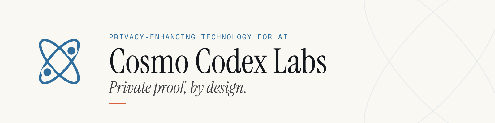

<picture>
  <source media="(prefers-color-scheme: dark)" srcset="./assets/banner-dark.svg">
  
</picture>

  <a href="#status">Status</a> ·
  <a href="#open-questions">Open questions</a> ·
  <a href="#how-we-publish">How we publish</a> ·
  <a href="#citing-our-work">Citing</a> ·
  <a href="#reporting-a-problem">Reporting a problem</a> ·
  <a href="https://cosmocodex.com">cosmocodex.com</a>

Cosmo Codex Labs is the research group of CosmoCodex Ltd, a UK company. We work on privacy-enhancing technology for AI: methods that let an organisation show what its AI systems reveal about people, with a proof or a measurement that someone outside the organisation can check.

## Status

What exists today, and what you can use.

| Work | Kind | Status |
|---|---|---|
| *Counting What Leaves: Maximal-Leakage Ledgers for AI Agents and Sealed Evaluations, and Their Limits* | Working paper | In preparation. Not yet posted. |
| Privacy-enhancing technologies: a working bibliography | Reading list | Corrected after a citation audit, 17 November 2026. Private; not yet public. |
| Discrepancy theory and rounding | Mathematics | Private. Nothing published yet. |
| Articles on privacy law, policy and technology | Articles | Published at [cosmocodex.com/research](https://cosmocodex.com/research). |

When something is released, it will be listed here with a link, a licence and a version.

## Open questions

These are questions we are working on. They are not results.

1. **Counting what leaves.** When an AI agent or a sealed evaluation answers questions about private data, how much can its answers reveal about one person, counted in bits of maximal leakage? Where does a per-person count stop protecting anyone, for example for groups or for linked records?
2. **Purpose-bound outputs.** Article 5(1)(b) of the GDPR requires personal data to be collected for specified purposes and not processed further in a way that is incompatible with them. Is there a formal definition of a purpose-bound output that a system can enforce and an auditor can check?
3. **"No inference", relative to the recipient.** The EDPB's draft [Guidelines 02/2026 on anonymisation](https://www.edpb.europa.eu/documents/guideline/guidelines-022026-on-anonymisation_en) set out three criteria for testing whether data is anonymous: no record isolation, no linkage and no inference. Can the inference criterion be stated as a formal test for a named recipient?
4. **Attesting what leaves, not only what runs.** Private inference services such as [Apple Private Cloud Compute](https://security.apple.com/documentation/private-cloud-compute/) let a device check which software a server runs. Can a service also prove what it releases and what it keeps?
5. **Machine-checked privacy claims.** Can the leakage bound that a release gate claims be proved in Lean, and the code that enforces it be tested against that proof?
6. **Sealed evaluations.** How much do published scores reveal about a secret test set, and how should repeated use of the set be budgeted?

If you know of prior work that answers one of these, please tell us. There is an [issue form](https://github.com/CosmoCodexLtd/.github/issues/new/choose) for it.

## How we publish

- Every number in a paper comes from code released with it, together with the command that regenerates it.
- Limits are stated as results, next to the claims they limit.
- Where we say a proof is machine-checked, we publish the Lean source, the toolchain version and the build command with it.
- Corrections are made in public, with a dated note of what changed.
- We do not claim compliance, anonymisation or certification that the work does not prove.

## Citing our work

Nothing here is citable yet: the working paper has no public version. When a paper, dataset or piece of code is released, it will have a persistent identifier (an arXiv identifier or a Zenodo DOI) and a `CITATION.cff` file, and this page will give its BibTeX entry. Please do not cite drafts.

## Reporting a problem

- **A security issue.** Read the [security policy](https://github.com/CosmoCodexLtd/.github/blob/main/SECURITY.md). Email info@cosmocodex.com with "Security" in the subject line, or use "Report a vulnerability" on the Security tab of a public repository where it is enabled. Please do not open a public issue.
- **An error in our work**, such as a wrong citation or a number that does not reproduce. Open an [issue](https://github.com/CosmoCodexLtd/.github/issues/new/choose) or email info@cosmocodex.com.

Contributions follow the [contributing guide](https://github.com/CosmoCodexLtd/.github/blob/main/CONTRIBUTING.md) and the [code of conduct](https://github.com/CosmoCodexLtd/.github/blob/main/CODE_OF_CONDUCT.md).

## Also from CosmoCodex Ltd

- **[TheVPNMatrix](https://thevpnmatrix.com)** compares VPN providers on 28 sub-criteria in six weighted categories. The [method](https://thevpnmatrix.com/methodology) is published. Some links on the site are affiliate links; see its [disclosure](https://thevpnmatrix.com/disclosure).
- **[Social Neuron](https://socialneuron.com)** is an AI platform for planning, creating and scheduling social media content.
- **[Consulting](https://cosmocodex.com/services)** on data protection, AI governance and online safety, for UK organisations.

Contact: info@cosmocodex.com

---

Cosmo Codex Labs is the research group of CosmoCodex Ltd, registered in England and Wales, company number 16627148. Registered office: 20 Wenlock Road, London, England, N1 7GU.
