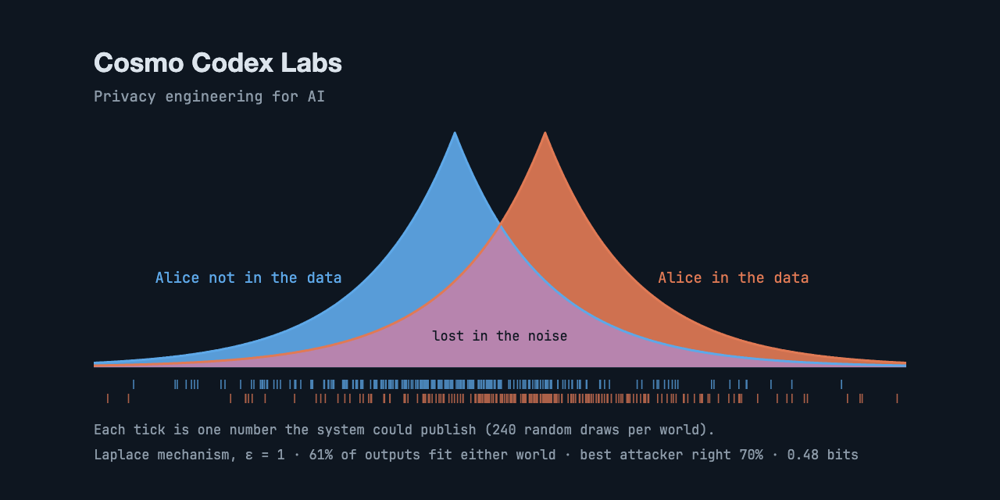

# Cosmo Codex Labs

Cosmo Codex Labs is the research group of CosmoCodex Ltd, a UK company. We research privacy engineering for AI: how to measure and limit what AI systems reveal about people.

Each paper is released here when it comes out, with its code, data and licence.

- *Counting What Leaves*: working paper on leakage ledgers for AI agents, in preparation.
- Articles: [cosmocodex.com/research](https://cosmocodex.com/research)
- Security reports: [security policy](https://github.com/CosmoCodexLtd/.github/blob/main/SECURITY.md)
- Contact: info@cosmocodex.com

CosmoCodex Ltd, registered in England and Wales, company number [16627148](https://find-and-update.company-information.service.gov.uk/company/16627148). Registered office: 20 Wenlock Road, London N1 7GU.
